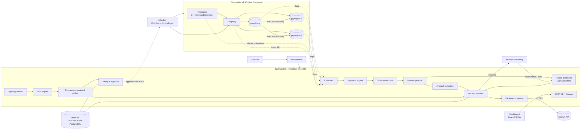

# FaultTwin AI — Architecture

Status: **Phase 0 target architecture.** Only the Phase 1 subset in §10 is implemented. Phase numbers
refer to the owner's master specification (Phases 0–12). Decisions with real alternatives are ADRs in
`docs/adr/`.

## 1. Guiding principles

1. **The C++ core is the product.** Ingestion, storage, feature extraction, detection, inference,
   simulation, ranking, recording, replay, safety and the API are native C++. Python exists only for
   offline training; TypeScript only for the dashboard.
2. **Modular monolith first.** One core process (`faulttwind`) composed of libraries with narrow
   interfaces. A component becomes its own process only for a stated reason (privilege, isolation,
   language, measured contention).
3. **Recommend, don't act.** No code path executes a recovery action against anything but the
   disposable lab, and that path requires a recorded human approval.
4. **Evidence over assertion.** Simulated vs observed is a type-level distinction; LLM claims must
   cite evidence; benchmarks are hypotheses until measured.
5. **Determinism where it matters.** Simulation, replay and feature extraction are reproducible.

## 2. System context



## 3. Process model

| Process | Language | Why it is separate |
|---|---|---|
| `faulttwind` | C++ | Core. All analysis, simulation and API. Unprivileged; no Docker socket. |
| `ft-faultctl` | C++ | **Privilege separation.** Needs the Docker API and Toxiproxy admin API to inject faults. Isolating it keeps the core unprivileged and makes the guard surface small and auditable. Runs only in the lab profile. |
| `ft-loadgen` | C++ | Generates workload and measures client-side latency with histograms; must not share CPU scheduling with the core to avoid measurement bias. |
| `ft-sim` | C++ | CLI front-end to the same `sim` library for batch/offline runs and determinism tests. Not a service. |
| `ml/` training | Python | Offline only, by design. Produces artifacts; never runs in the serving path. |
| dashboard | TS | Static bundle served by nginx (prod profile) or Vite (dev). |
| meta-db | PostgreSQL | FaultTwin's own state (incident catalog, approvals, audit). **Separate from the monitored cluster** so that faults never corrupt the observer. |
| Prometheus, Grafana | — | Observability of FaultTwin itself. |

Communication: `faulttwind` ↔ `ft-faultctl` over a local REST API on an internal Compose network,
authenticated with a lab token (ADR-0003 explains why not gRPC yet). `ft-loadgen` pushes histogram
snapshots to `faulttwind` over REST. The Protobuf schema is still defined in Phase 3 and used for the
incident log format, so introducing gRPC later is a transport change, not a model change.

## 4. Component catalogue

Each component is a CMake library with public headers in `include/faulttwin/<module>/` and sources
in `src/<module>/`. A module directory is created only in the phase that implements it; no empty
placeholders. The master specification lists `core, telemetry, detection, topology, simulation,
recovery, storage, api`; the extra modules below (`concurrency`, `collectors`, `features`,
`prediction`, `faults`, `incidents`, `explain`, `safety`, `observability`) may be merged into those
if they stay small, and are only split out with a recorded reason. Dependency cycles are forbidden.

| # | Library | Responsibility | Key interfaces (sketch) | Depends on |
|---|---|---|---|---|
| 1 | `core` | Result/error types, clock abstraction, IDs, config loading, structured logging facade | `Clock` (`SystemClock`, `ManualClock`), `Result<T>`, `Logger` | — |
| 2 | `telemetry` | Event model, units, validation, protobuf mapping | `TelemetryEvent`, `MetricId`, `EntityRef` | core |
| 3 | `concurrency` | Bounded MPMC queue, worker pool, stop tokens, backpressure policies | `BoundedQueue<T>`, `WorkerPool`, `BackpressurePolicy` | core |
| 4 | `collectors` | PostgreSQL, cgroup, Toxiproxy and RTT-probe collectors | `ICollector { start(sink, stop_token); describe(); }` | telemetry, concurrency |
| 5 | `ingest` | Fan-in pipeline: validate → enrich → route to storage and feature stages | `IEventSink`, `IngestPipeline` | telemetry, concurrency |
| 6 | `tsdb` | In-memory sharded series store with bounded retention + on-disk segments | `ISeriesStore { append(); query(range, step); }` | telemetry |
| 7 | `features` | Windowed feature extraction (identical definitions to Python reference) | `FeatureExtractor`, `FeatureVector`, `FeatureSchema` | tsdb |
| 8 | `detection` | Deterministic baseline: thresholds, EWMA, median/MAD | `IDetector { evaluate(window) -> Detections }` | features |
| 9 | `prediction` | ONNX Runtime session, model registry, schema check | `IPredictor { predict(FeatureVector) -> Prediction }` | features |
| 10 | `topology` | Live cluster graph (roles, replication edges, health) | `TopologySnapshot`, `TopologyModel` | telemetry |
| 11 | `sim` | Discrete-event engine + database behavior models | `Simulation`, `Event`, `Model`, `SimRng` | core, topology |
| 12 | `faults` | Experiment spec, guard evaluation, client for `ft-faultctl` | `ExperimentSpec`, `IEnvironmentGuard` | core |
| 13 | `recovery` | Strategy definitions, Monte-Carlo evaluation on `sim`, ranking | `IStrategy`, `Evaluator`, `Ranker`, `Outcome<Provenance>` | sim, topology |
| 14 | `incidents` | Append-only incident log, catalog in meta-db, replay driver | `IncidentRecorder`, `ReplaySession` | telemetry, tsdb, recovery |
| 15 | `explain` | Evidence bundle builder, OpenAI client, claim validator, budget | `IExplainer`, `EvidenceBundle`, `ClaimValidator` | incidents |
| 16 | `safety` | Approval workflow, action allow-list, audit log | `ApprovalController`, `ActionRequest` | faults, incidents |
| 17 | `api` | Drogon controllers, DTOs, validation, OpenAPI conformance | controllers per resource | all of the above (composition root only) |
| 18 | `observability` | Prometheus metrics registry/exporter, health/readiness | `MetricsRegistry`, `HealthRegistry` | core |

**Dependency injection.** Components receive collaborators through constructor parameters typed as
interfaces (or concepts where static polymorphism is cheaper on hot paths). The only place that
constructs concrete types is `apps/faulttwind/main.cpp` (the composition root). Tests substitute
fakes (`ManualClock`, `InMemorySeriesStore`, `FakeOpenAiTransport`, …).

## 5. Data flow and threading

```
collectors (N threads, one per collector, I/O-bound)
   │ TelemetryEvent (by value, small, move-only buffers)
   ▼
BoundedQueue<Event> ingest_q   ← backpressure policy per source
   │
WorkerPool "ingest" (K threads) — validate, enrich, route
   ├─► tsdb shards (sharded by series hash; one mutex per shard)
   └─► feature scheduler (tick every Δt = 5 s by default)
           │
           ▼ FeatureVector per entity
        detection (sync, cheap) + prediction (ORT, intra-op threads = 1)
           │
           ▼ Detections / Predictions → incident recorder → API / UI

On demand: recovery evaluation → WorkerPool "sim" (S threads, bounded job queue)
           each job = one seeded simulation run; results aggregated per strategy.
```

- Drogon runs its own event-loop threads for HTTP. Controllers never block them: long work is
  posted to the `sim` pool and returned as a job resource (`202 Accepted` + polling/SSE).
- Thread counts (N, K, S) are configuration. Defaults are derived from `hardware_concurrency` and
  documented; the `sim` pool is capped so ingestion always has headroom.
- Shutdown order (reverse of start): stop API accepting → stop collectors → drain `ingest_q` with
  deadline → stop pools (`std::jthread` + `std::stop_token`) → flush tsdb segments and incident log →
  close DB connections. Each step logs what it drained or dropped.

## 6. Key designs per component

### 6.1 Telemetry event model
`TelemetryEvent { schema_version, event_id, source, entity (cluster/node), metric, value (double |
int64 | histogram ref), unit, observed_at, ingested_at, labels (small flat map, bounded) }`.
Units are an enum, not strings. Protobuf (`proto/faulttwin/v1/telemetry.proto`) is the wire and
storage schema; the C++ struct is the in-memory form, with an explicit, tested mapping.

### 6.2 Bounded queue and worker pool
A mutex + two condition-variable ring buffer is the first implementation (correct, simple, TSan
friendly). A lock-free variant (Vyukov bounded MPMC) is added only if the Phase 11 benchmark shows the
mutex queue is the bottleneck. Both satisfy the same concept so benchmarks compare them directly
(ADR-0006).

### 6.3 Time-series store
- Hot tier: per-series fixed-capacity ring buffers of `(timestamp, value)` in shards; capacity from
  retention × scrape interval. Constant memory.
- Warm tier: append-only segment files (length-delimited Protobuf blocks, CRC32C per block),
  rolled by time; used by replay and dataset export. Lives in `src/storage`.
- Query: range + step with aggregation (last, avg, max, p95 over window). Not a general TSDB; the
  scope is deliberately what features and the UI need (ADR-0005).

### 6.4 Features, detection, prediction
- One feature spec (`ml/feature_spec.yaml`) is the source of truth; C++ and Python implement it and a
  golden-fixture test asserts equality within 1e-9 relative tolerance.
- Example features per node: replication lag (bytes, seconds) and its slope over 60 s, p95/p99 query
  latency, connections/`max_connections`, CPU and memory utilization, WAL generation rate, error
  rate, active toxic latency, RTT probe p95.
- Baseline detector produces typed `Detection{rule_id, severity, evidence_refs}` and is always on.
  The ML prediction never suppresses a baseline detection.
- Label definition (for training and evaluation): a *failure* is a window where any SLO is breached —
  replica lag > 30 s, primary unavailable > 5 s, p99 latency > 500 ms for 30 s, or connection
  refusals. Target = failure starts within horizon H. Values are configuration, recorded in the
  dataset manifest.
- Model: logistic regression, random forest and gradient boosting are all trained on the same
  leakage-safe splits; the selection is made on validation metrics, inference cost and ONNX
  convertibility, and may legitimately be "rules are as good" (ADR-0008, Phase 7).

### 6.5 Discrete-event simulator
- Event queue: binary heap (`std::priority_queue` over a vector) keyed by `(sim_time_ns, seq_no)`;
  the monotonic `seq_no` breaks ties so ordering is total and deterministic.
- Time: integer nanoseconds (`int64_t`), never floating point.
- RNG: a fixed, specified generator (PCG64 or xoshiro256**) **and in-house distribution functions**,
  because `std::uniform_real_distribution` & co. are not specified identically across standard
  libraries; using them would break cross-platform reproducibility (ADR-0007).
- Each run is single-threaded; parallelism is across runs (embarrassingly parallel Monte-Carlo).
  Per-run seed = `hash(base_seed, strategy_id, run_index)`.
- Models: `Node` (CPU/IO service queues, connection slots), `Workload` (Poisson or replayed arrivals,
  read/write mix), `Replication` (WAL bytes produced, shipping bandwidth, apply rate), `Link`
  (latency, jitter, loss, partition), `FailureProcess` (scheduled or stochastic failures).
- Memory: events in a `std::pmr::monotonic_buffer_resource` per run where profiling justifies it.
- Validation: twin is calibrated against lab experiments; error metrics (e.g. lag trajectory MAE,
  downtime error) are reported in the benchmark report, never assumed.

### 6.6 Recovery evaluation and ranking
Candidates (master specification, Module H): continue monitoring, reduce incoming workload, wait for
replica catch-up, restore network connectivity, restart a failed database, prepare a controlled
failover, promote an eligible replica after safety checks.

Pipeline: (1) **safety filter** rejects candidates that violate hard constraints (stale topology,
unreachable or lagging replica beyond the RPO limit, split-brain risk, missing authorization,
unsupported strategy) and records why; (2) each remaining candidate is simulated on a forked,
calibrated twin over `M` seeded runs; (3) feasible candidates are ranked; (4) if no candidate is
feasible, or the uncertainty interval of the best two overlaps beyond a configured tolerance, the
result is **ABSTAIN**. Lower predicted downtime never overrides a failed safety check.

| Criterion | Definition | Direction |
|---|---|---|
| Expected downtime | seconds without write (and separately read) availability | lower |
| Transaction-loss exposure / RPO | WAL bytes / transactions not replayed on the promoted node | lower; hard limit |
| RTO compliance | recovery time ≤ configured RTO | constraint + score |
| Recovery risk | reversibility × blast radius (ordinal) | lower |
| Resource overhead | extra CPU/IO/connections the strategy consumes | lower |
| Uncertainty | spread across seeded runs; rank stability under bootstrap | reported |

`Outcome` values carry `provenance: simulated | observed`, so code and UI cannot mix them silently.
Execution, if ever added, is lab-only and needs human approval, authorization, topology
revalidation, fencing checks and an audit record.

### 6.7 Incident recording and replay
- Incident = time range + entities + linked records. Records are appended to the incident log
  (Protobuf, CRC per record, monotonic sequence). The catalog lives in meta-db.
- Replay drives a `ManualClock` and re-feeds recorded telemetry into the same pipeline; the replay
  test asserts identical detections and predictions (same model version).

### 6.8 Explanation service
- Input: `EvidenceBundle` (each item has a stable ID, type, timestamp range, values).
- Call: OpenAI API with structured output (JSON schema): `{summary, claims:[{text, evidence_ids,
  quantities}], unknowns[], confidence}`. Model name is configuration.
- Validation: every `evidence_id` must exist in the bundle; quantities are compared to the cited
  evidence (tolerance configurable); unsupported claims are dropped and the explanation is marked
  "partially verified".
- Guardrails: request timeout, retry with jittered backoff on 429/5xx, circuit breaker, max tokens
  per request, daily budget counter persisted in meta-db, response cache keyed by bundle hash.
- The service has no access to any client other than its HTTPS transport (enforced by construction:
  it receives only an `IHttpTransport`).

### 6.9 Fault injection and environment guards
`ft-faultctl` executes only if **all** guards pass:
1. Process started with `FAULTTWIN_ENV=lab` *and* a lab token file created by the lab bootstrap
   script exists and matches.
2. Target container carries label `faulttwin.role=lab-target` and belongs to the allow-listed Compose
   project name.
3. Target DSN host resolves to the internal Compose network (RFC 1918/link-local) and is in the
   allow-list; any other host is refused.
4. The target PostgreSQL instance has `faulttwin.lab = on` set (custom GUC) — a property a
   production server would not have.
5. Experiment duration ≤ configured max; one active experiment per target; auto-revert registered
   before the fault is applied.
Every evaluation (pass or fail) is written to the audit log.

Fault mechanisms: Toxiproxy toxics (latency, bandwidth, reset_peer, timeout) on client and
replication paths; `docker pause/stop` for unavailability; `docker update --cpus/--memory` and a
`stress-ng` sidecar for resource pressure; `ALTER SYSTEM SET recovery_min_apply_delay` for
replication delay.

### 6.10 Safety and approval
- `ActionRequest {strategy, target, parameters, evidence, requested_by}` → `pending` →
  `approved|rejected|expired` by a human via API/UI → executed only by `ft-faultctl` in the lab.
- Production: the only output is an exportable runbook (Markdown/JSON). There is no production
  executor in the codebase.

### 6.11 REST API
Resources: `/clusters`, `/nodes`, `/metrics/query`, `/detections`, `/predictions`, `/incidents`,
`/incidents/{id}/replay`, `/simulations` (jobs), `/recovery/evaluations`, `/explanations`,
`/approvals`, `/experiments` (lab only), `/healthz`, `/readyz`, `/metrics` (Prometheus).
OpenAPI 3.1 spec in `api/openapi.yaml`; contract tests check responses against it.

### 6.12 Observability
Prometheus metrics for queue depth, drops, ingest throughput, stage latency histograms, inference
latency, simulation jobs, LLM calls/cost/errors. Grafana dashboards provisioned from files.
JSON logs with `trace_id` propagated from HTTP request to jobs.

## 7. Security model (summary; full threat model in Phase 11)
- Core process unprivileged, read-only root filesystem, no Docker socket.
- `ft-faultctl` is the only component with Docker socket access, and only in the `lab` Compose profile.
- Secrets: `OPENAI_API_KEY`, DB passwords and API keys via Docker secrets / env files excluded from
  git; redacted in logs by the logging facade.
- API key auth on all mutating endpoints; CORS restricted to the dashboard origin.
- LLM output is rendered as text (no HTML injection), never parsed as commands.

## 8. Technical trade-offs (summary)

| Decision | Chosen | Alternative | Why | ADR |
|---|---|---|---|---|
| Process structure | Modular monolith + privileged fault controller | Microservices | Fewer moving parts, real boundaries via libraries; split only where privilege demands | 0002 |
| Internal RPC | REST now, Protobuf schema now, gRPC deferred | gRPC everywhere | No cross-process hot path yet; gRPC adds build cost (large dependency) without a measured benefit | 0003 |
| Dependencies | Phase 1: CMake FetchContent pinned to a commit SHA (GoogleTest only). From Phase 5: vcpkg manifest with pinned baseline (proposed) | Conan; apt-only | Smallest thing that is reproducible now; revisit when heavy deps (Drogon, ORT, gRPC) arrive | 0004 |
| Telemetry storage | Custom bounded in-memory + segment files | Prometheus/TimescaleDB as primary store | Demonstrates native engineering; scope is small; Prometheus kept for self-observability | 0005 |
| Queue | Mutex/condvar ring first, lock-free if benchmark justifies | Lock-free first | Correctness and TSan clarity first; optimization is measured | 0006 |
| Simulator RNG | Specified PRNG + in-house distributions | `<random>` distributions | Cross-stdlib reproducibility | 0007 |
| ML model | Compare LR / RF / gradient boosting, select empirically → ONNX | Deep sequence models | Tabular windowed features, small data, ONNX support, interpretability | 0008 |
| LLM role | Explanation only, validated citations | Agentic remediation | Safety: the LLM must never control infrastructure | 0009 |
| Async I/O | Drogon/Trantor for HTTP; Boost.Asio only for RTT probes/timers if needed | Asio everywhere | Avoid two event-loop frameworks unless a component needs raw sockets | 0003 |

## 9. Known risks
| Risk | Impact | Mitigation |
|---|---|---|
| Building gRPC/ORT/Drogon from source via vcpkg is slow | Long CI and first build | Binary caching in CI; gRPC deferred; ORT via official prebuilt if vcpkg port lags |
| TSan on newer Linux kernels can abort with high ASLR entropy | TSan job failing | CI sets `vm.mmap_rnd_bits=28` before TSan runs (Phase 1 workflow) |
| Docker Desktop on macOS hides real host metrics | CPU/mem features reflect the VM | Documented assumption A3; features use utilization ratios vs container limits |
| Small, synthetic datasets overfit | Inflated metrics | Grouped split by scenario, held-out fault type, report CIs and FP/hour |
| Twin may not match reality | Misleading rankings | Calibration error reported; outcomes labelled simulated; rank stability shown |

## 10. Implemented so far (Phases 1–4)

| Component | Location | Status |
|---|---|---|
| Telemetry value model (`NodeId`, `NodeRole`, `RawTelemetrySample`, `TelemetrySample`) | `include/faulttwin/telemetry/`, `src/telemetry/` | Implemented, unit tested |
| Validation contracts and freshness classification | `validation.hpp/.cpp` | Implemented, unit tested |
| Deterministic synthetic generator (SplitMix64) | `synthetic.hpp/.cpp` | Implemented, unit tested |
| `faulttwin-synth` CLI | `src/cli/` | Implemented, tested via CTest |
| Build, presets, sanitizers, CI | root `CMakeLists.txt`, `CMakePresets.json`, `cmake/`, `.github/workflows/ci.yml` | Built and tested on Linux; CI green on `b36a903` |
| `BoundedQueue<T>` (3 overload policies, timeouts, `stop_token` cancellation, close, `pop_batch`), `UnboundedQueue<T>` reference, `QueueLike` concept | `include/faulttwin/concurrency/`, `src/concurrency/` | Phase 2: implemented, unit + stress tested (incl. TSan) |
| `NodeOrderTracker`, `EventProcessor`, `IngestPipeline` (jthread consumers, drain-deadline shutdown), single-threaded baseline | `include/faulttwin/ingest/`, `src/ingest/` | Phase 2: implemented, tested (incl. TSan) |
| Google Benchmark suite and scripts | `bench/`, `scripts/run-benchmarks.sh`, `scripts/summarize-benchmarks.py` | Phase 2: measured in a cloud container only |
| PostgreSQL lab, collectors, `faulttwin-monitor` | `compose.yaml`, `lab/`, `include/faulttwin/collectors/`, `src/collectors/`, `src/monitor/` | Phase 3: tested against the lab (Linux container, macOS, CI) |
| Features: `Observation`, `RollingWindow` (Welford), `FeatureSchema` v1, `FeatureExtractor`, adapters | `include/faulttwin/features/`, `src/features/` | Phase 4: implemented, unit tested, golden fixture (ADR-0016) |
| Detection: `Rule`, `RuleEngine`, `OnlineDetector`, scenarios, scoring, tuning; `faulttwin-detect`; `faulttwin-monitor --detect` | `include/faulttwin/detection/`, `src/detection/`, `src/detect/` | Phase 4: implemented, tested; evaluated on synthetic scenarios only (ADR-0017) |
| Learned comparison detectors: `KnnDetector`, `AveragedPerceptron`, `Standardizer`, `ScoreAlerter`, `train_and_tune` | `include/faulttwin/detection/learned.hpp`, `src/detection/learned.cpp` | Phase 4: implemented, tested; synthetic scenarios only; not the Phase 7 model (ADR-0018) |

Phase 2 differences from the target design in §4–§6: there is no `core` library yet (the only
clock abstraction needed is the injectable `NowFn`), the event type is still the Phase 1
`RawTelemetrySample` wrapped in `IngestEvent` (not the full `TelemetryEvent` of §6.1), and the
pipeline has one stage (validate → order → sink) with no routing to storage or features.

Everything else in this document is design only.

Phase 4 differences from §4–§6: there is no `tsdb` yet; features are computed from per-series
in-memory windows inside the extractor (enough for one process and one evaluation thread). The
detector interface is a concrete `RuleEngine` over `FeatureVector`s rather than an `IDetector`
abstraction, because there is one implementation; EWMA and median/MAD detectors are deferred
(ADR-0017). `ml/feature_spec.yaml` does not exist yet; the C++ `FeatureSchema` plus the golden
fixture from `scripts/features-reference.py` are the current contract.
